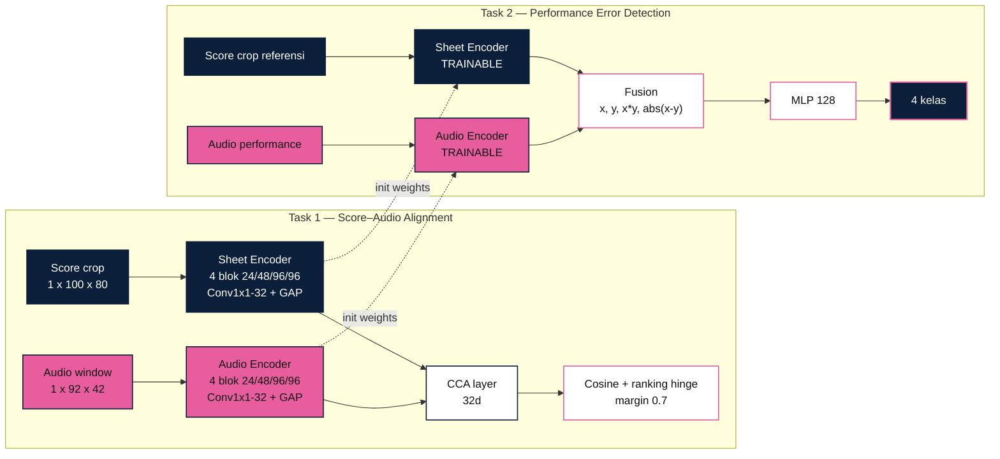

# Arsitektur Baseline Dorfer

**Satu encoder:** 2× Conv3×3 + BN + ELU + MP2, diulang untuk 24 → 48 → 96 → 96
channel, lalu Conv1×1-32 + BN + GAP → 32-d.

**Catatan:**
- Task 1 dilatih dari nol, CCA aktif, warmup 200 step, running covariance `alpha=0.05`.
- Task 2 memakai bobot Task 1 sebagai inisialisasi dan melatih kedua encoder.
- Tidak ada komponen frozen di baseline ini.
- Task 2 tidak memakai CCA; classifier memakai output trunk 32-d.
