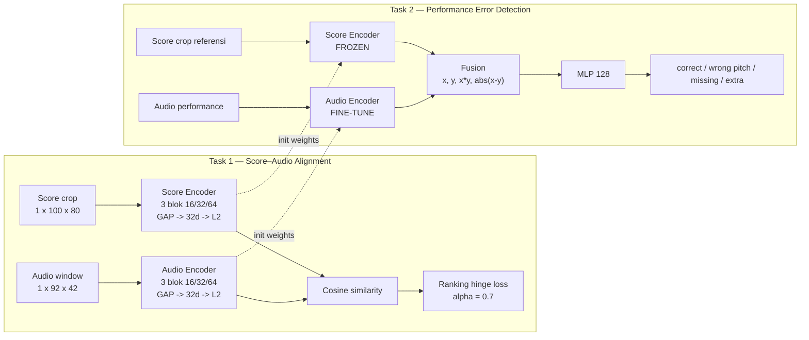

# Ablation: Dorfer-lite (bukan baseline)

> Dokumen ini menyimpan run reduced-capacity sebagai ablation. Baseline resmi memakai Dorfer penuh di `reports/architecture_dorfer.md`.

**Detail satu encoder:** 2× Conv3×3 + BN + ELU + MP2, diulang untuk 16 → 32 → 64 channel, lalu Conv1×1-32 + BN + GAP.

**Catatan:**
- Task 1 dilatih dari nol; Task 2 memakai bobot encoder Task 1.
- Task 2 membekukan Score Encoder dan hanya fine-tune Audio Encoder + fusion classifier.
- Tidak ada CCA layer pada profil Dorfer-lite.

## Angka ablation (dari branch `feature/baseline-dorfer-lite`)

| Metrik | Dorfer-lite | Dorfer full |
|---|---:|---:|
| Task 1 val MRR | 0.0086 | 0.0100 |
| Task 1 snippet R@1 | 0.15% | 0.10% |
| Task 1 snippet MRR | 0.0087 | 0.0075 |
| Task 1 page-conditioned R@1 | 27.5% | 26.0% |
| Task 1 5-candidate R@1 | 25.6% | 27.3% |
| Task 1 piece ID Rk@1 | 54.2% | 41.2% |
| Task 2 4-class accuracy | 99.0% | (lihat summary) |

Angka ini menunjukkan kapasitas bukan faktor pembatas pada 17 train pieces: model kecil dan model penuh memberi hasil sebanding, dan model penuh justru lebih cepat overfit. Karena itu baseline resmi tetap memakai arsitektur penuh untuk keperluan perbandingan, sedangkan profil lite hanya menjadi ablation.
