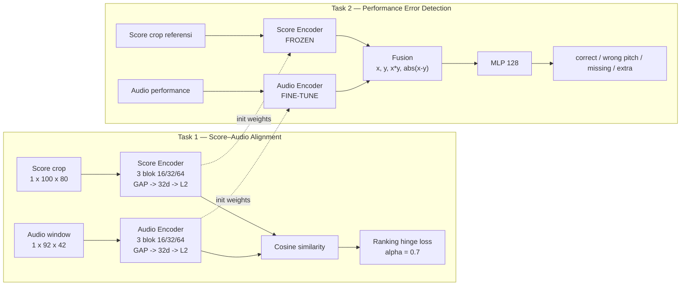

# Arsitektur Dorfer-lite

**Detail satu encoder:** 2× Conv3×3 + BN + ELU + MP2, diulang untuk 16 → 32 → 64 channel, lalu Conv1×1-32 + BN + GAP.

**Catatan:**
- Task 1 dilatih dari nol; Task 2 memakai bobot encoder Task 1.
- Task 2 membekukan Score Encoder dan hanya fine-tune Audio Encoder + fusion classifier.
- Tidak ada CCA layer pada profil Dorfer-lite.
