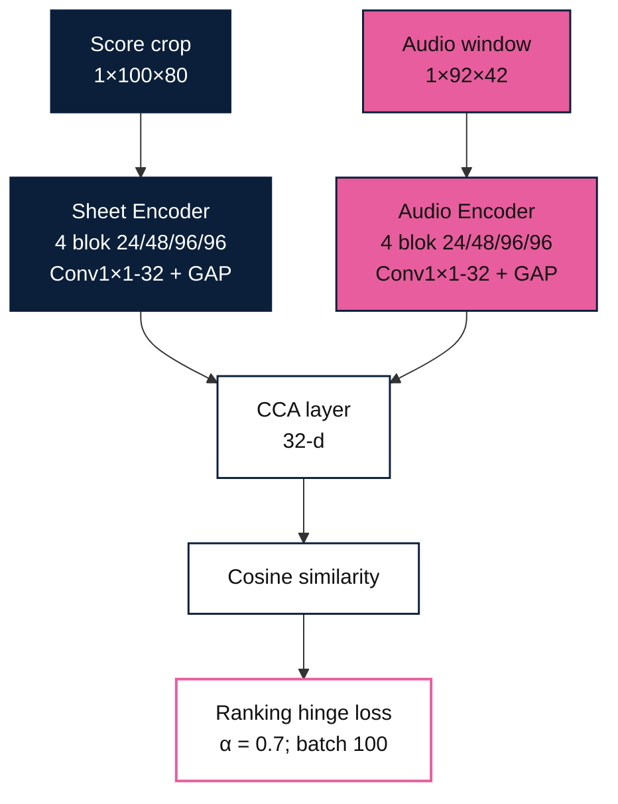
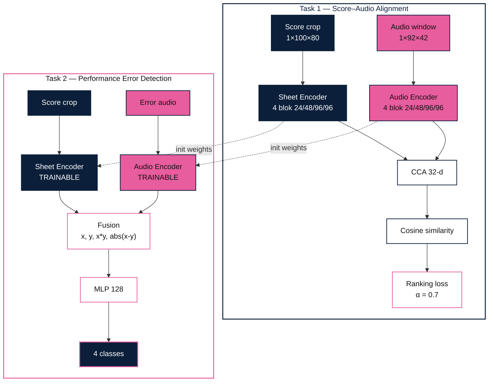
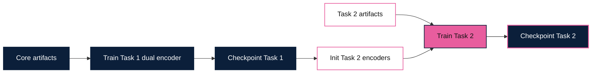

# Dorfer, Dijelaskan dari Nol

Dokumen ini menjelaskan:

1. model **Dorfer** dari paper,
2. **baseline Task 1** (Dorfer penuh),
3. **baseline Task 2** (Dorfer penuh, kedua encoder dilatih),
4. bagaimana **Task 1 dan Task 2 disambungkan**.

Ditulis untuk pembaca yang belum pernah melihat arsitektur ini. Tidak perlu paham CNN atau retrieval sebelumnya.

---

## Ringkasan 1 menit

Bayangkan dua hal:

- **Partitur** = gambar yang menunjukkan nada yang *seharusnya* dimainkan.
- **Audio** = suara yang *benar-benar* dimainkan.

Model Dorfer belajar menerjemahkan keduanya ke bahasa yang sama: sebuah vektor 32 angka. Setelah berada di bahasa yang sama, partitur dan audio bisa dibandingkan dengan cosine similarity.

- **Task 1**: diberikan audio, cari bagian partitur yang cocok.
- **Task 2**: diberikan referensi nada dari partitur dan audio yang dimainkan, tentukan apakah permainannya benar atau jenis kesalahannya.

Model Dorfer adalah model dari paper, dan itulah yang kita pakai sebagai baseline: arsitektur penuh, dilatih pada subset pilot karena keterbatasan CPU dan data.

---

## 1. Dua modalitas yang harus dipertemukan

### 1.1 Gambar partitur

Dari halaman partitur, preprocessing memotong **crop notehead** berukuran 160×200 piksel di sekitar satu kepala nada. Crop ini berisi:

- kepala nada,
- garis staff,
- sedikit konteks di sekitarnya.

Model tidak membaca seluruh halaman; ia melihat potongan kecil di sekitar satu nada. Sebelum masuk model, crop diperkecil menjadi **80×100** piksel dan dinormalisasi.

### 1.2 Audio

Audio tidak diberikan sebagai waveform mentah, tetapi sebagai **spectrogram**:

- sumbu horizontal = waktu (42 frame ≈ 2,1 detik),
- sumbu vertikal = frekuensi (92 bin),
- warna = energi pada frekuensi dan waktu tersebut.

Bentuk array-nya `[42, 92]` (frame × bin). Model memakai bentuk `[92, 42]` (bin × frame), jadi array di-transpose.

### 1.3 Pasangan positif

MSMD sudah menyediakan alignment: satu notehead di partitur terhubung ke satu onset nada di audio. Pasangan inilah yang disebut **positive pair**:

```
crop notehead  ↔  window audio di sekitar onset nada yang sama
```

Tujuannya: model belajar bahwa kedua hal ini adalah “hal yang sama” dalam dua bentuk berbeda.

---

## 2. Ide dasar: encoder dan embedding

### Encoder

Encoder adalah **penerjemah**. Ia menerima gambar atau audio, lalu menghasilkan daftar angka yang disebut **embedding**.

```
gambar partitur  →  [encoder gambar]  →  vektor 32 angka
audio            →  [encoder audio]   →  vektor 32 angka
```

Dua encoder berbeda karena inputnya berbeda, tetapi outputnya sama-sama 32 angka. Di ruang 32 dimensi itulah kedua modalitas dibandingkan.

### Apa itu CNN, secara singkat?

Encoder di sini adalah **CNN** (*Convolutional Neural Network*). Cara kerjanya kira-kira:

- **Conv3×3**: filter kecil yang bergeser di seluruh gambar/spectrogram untuk mendeteksi pola lokal (garis staff, kepala nada, harmonic, onset).
- **MaxPool 2×2**: memperkecil ukuran gambar agar lebih ringkas dan fokus pada pola penting.
- **BN** (*Batch Normalization*): menstabilkan angka-angka di dalam jaringan saat training.
- **ELU**: fungsi non-linear yang membantu jaringan mempelajari pola kompleks.
- **GAP** (*Global Average Pooling*): merata-ratakan peta fitur terakhir menjadi satu vektor 32 angka.

Semakin dalam blok CNN, semakin abstrak pola yang ditangkap: dari garis dan tepi, menjadi bentuk not, lalu menjadi pola musikal yang lebih umum.

### Embedding

Embedding bukan gambar dan bukan suara. Ia adalah “sidik jari” dari isi musik:

- nada tinggi/rendah,
- pola harmonik,
- bentuk visual notasi,
- konteks staff.

Kita tidak bisa membaca 32 angka itu sebagai manusia, tetapi model bisa menghitung jaraknya.

### Cosine similarity

Untuk membandingkan dua vektor, dipakai **cosine similarity**:

- nilainya mendekati **1** kalau dua vektor searah (mirip),
- mendekati **0** kalau tidak berhubungan,
- mendekati **-1** kalau berlawanan.

Sebelum dibandingkan, vektor di-**L2-normalize**: panjangnya dibuat 1. Dengan begitu, perbandingan hanya soal arah, bukan panjang vektor.

### Kenapa 32 dimensi?

32 cukup kecil agar cepat, tetapi cukup besar untuk menyimpan informasi nada dan konteks. Paper Dorfer memakai 32, dan baseline kita juga memakai 32.

---

## 3. Ide dasar: ranking loss

Model tidak dilatih dengan label “benar/salah” biasa. Ia dilatih dengan **pasangan**:

- satu **positive pair**: partitur dan audio yang cocok,
- banyak **negative pairs**: partitur dan audio yang tidak cocok.

Loss yang dipakai adalah **ranking hinge loss**:

```
penalti = max(0, margin - skor(pasangan benar) + skor(pasangan salah))
```

Dalam kata-kata:

> Pasangan yang benar harus lebih mirip daripada pasangan yang salah, dengan selisih minimal sebesar `margin`.

Kalau pasangan benar sudah jauh lebih mirip, tidak ada penalti. Kalau belum, model didorong untuk memperbaiki.

### In-batch negatives

Kita tidak perlu membuat file negatif khusus. Dalam satu batch berisi 100–128 pasangan, semua pasangan lain di batch itu dianggap negatif. Ini disebut **in-batch negatives**.

Contoh: batch berisi 100 pasangan. Untuk pasangan ke-1, pasangan ke-2 sampai ke-100 dipakai sebagai contoh “tidak cocok”.

### Margin

Paper memakai `margin = 0.7`. Baseline kita juga memakai 0.7.

---

## 4. Dorfer penuh (model paper)

Ini adalah model referensi dari paper. **Kita tidak melatih versi penuh ini**; kita memakai versi lite. Tetapi penting untuk memahami aslinya.


### Arsitektur

| Bagian | Isi |
|---|---|
| Input sheet | 80×100 grayscale |
| Input audio | 92×42 spectrogram |
| Blok CNN | 4 blok, masing-masing 2× Conv3×3 |
| Channel | 24 → 48 → 96 → 96 |
| Setiap blok | Conv3×3 + BN + ELU + MaxPool 2×2 |
| Akhir | Conv1×1-32 + BN |
| Pooling | Global Average Pooling → 32 angka |
| Embedding | CCA layer + L2 normalize |
| Loss | Ranking hinge, margin 0.7 |

### Apa itu CCA?

CCA (*Canonical Correlation Analysis*) adalah lapisan yang mencoba membuat dua representasi “saling berkorelasi”.

Analogi sederhana:

> Dua orang menjelaskan lagu yang sama, satu lewat gambar dan satu lewat suara. CCA mencari “arah pembicaraan” yang membuat kedua penjelasan itu menunjuk ke hal yang sama.

Tanpa CCA, kedua encoder hanya dinormalisasi lalu dibandingkan. Dengan CCA, ruang fitur sedikit diputar/diproyeksikan agar pasangan yang benar lebih sejajar.

### Training paper

- Optimizer: Adam, learning rate awal `2e-3`.
- Batch: 100.
- Loss: ranking hinge, margin 0.7.
- Negatif: semua sampel lain dalam batch.
- Augmentasi gambar: scaling 95–105%, translasi.
- Augmentasi audio: beberapa soundfont dan variasi tempo.
- Learning rate diturunkan jika validasi tidak membaik.

### Evaluasi paper

- **Snippet retrieval**: audio → sheet dan sheet → audio.
- Metrik: R@1, R@25, MRR, median rank.
- **Piece identification**: top-25 snippet voting.
- Kandidat retrieval dibatasi sekitar 2.000.

---

## 5. Baseline: Dorfer penuh, bukan versi lite

Baseline resmi memakai arsitektur paper apa adanya. Yang dipersingkat hanya jadwal training dan skala data, bukan kapasitas model. Ini penting supaya kontribusi model yang diusulkan nanti bisa diukur terhadap baseline yang benar.

| Komponen | Dorfer (paper) | Baseline kita |
|---|---|---|
| Blok CNN | 4 blok | 4 blok |
| Channel | 24/48/96/96 | 24/48/96/96 |
| CCA | ya | ya |
| Embedding | 32-d | 32-d |
| Loss | ranking hinge 0.7 | ranking hinge 0.7 |
| Task 1 batch | 100 | 100 |
| Task 2 batch | — | 256 |
| Task 1 epoch | panjang | 8 |
| Task 2 epoch | — | 8 |
| Train pieces | 360 | 17 (pilot) |

Yang **tetap**: dua encoder, 4 blok, CCA, embedding 32-d, cosine similarity, ranking loss, dan protokol evaluasi retrieval.

Yang **berbeda**: jumlah train pieces dan durasi training. Karena itu, angka absolut masih belum sebanding dengan paper, tetapi arsitekturnya sebanding.

**Ablation yang disimpan:** run sebelumnya memakai profil kecil 3 blok 16/32/64 tanpa CCA. Profil itu tidak dipakai sebagai baseline; ia hanya disimpan sebagai ablation reduced-capacity di `reports/architecture_dorfer_lite.md`.

---

## 6. Baseline Task 1 — Score–Audio Alignment

### Tujuan

Diberikan potongan audio, cari lokasi partitur yang cocok. Pada implementasi kita, lokasi yang dicari adalah **system/baris** partitur.

### Diagram



### Cara kerja

1. Crop notehead masuk ke **Sheet Encoder**.
2. Window audio masuk ke **Audio Encoder**.
3. Masing-masing encoder menghasilkan vektor 32-d.
4. **CCA** menyelaraskan kedua ruang fitur, lalu vektor di-L2-normalize.
5. Cosine similarity mengukur kemiripan.
6. Ranking loss mendorong pasangan yang benar agar lebih mirip daripada pasangan salah.

### Data training

- 28.730 positive pairs dari 17 train pieces.
- Satu notehead bisa punya lebih dari satu performance.
- Negatif dibuat in-batch.

### Training

- 8 epoch (maksimum), early stop 3.
- Batch 100 (sesuai paper).
- Adam `2e-3`, weight decay `1e-4`.
- CCA mulai di-update setelah 200 step warmup, memakai running covariance `alpha = 0.05`.
- Augmentasi gambar: scaling dan translasi.
- Augmentasi audio: onset shift dan tempo jitter ±10%.

### Evaluasi

**1. Snippet retrieval**

- Audio query → ranking semua crop notehead.
- Sheet query → ranking semua window audio.
- Metrik: R@1/5/10/25, MRR, median rank.
- Protokol paired: satu window per notehead, sekitar 2.018 kandidat.
- Protokol extended: semua 8.072 window.

**2. System localization**

- **Page-conditioned**: diberikan halaman, ranking system di halaman itu.
- **5-candidate**: satu positif + empat negatif.
- **Full collection**: ranking seluruh 36 system test.
- Skor system = nilai cosine tertinggi terhadap notehead anggotanya.

**3. Piece/page identification**

- Ambil top-25 snippet, voting ke piece/page.

### Hasil pilot dan cara membacanya

| Metrik | Hasil |
|---|---:|
| Val MRR (model selection) | 0.0100 |
| Random val MRR | 0.0032 |
| Snippet R@1 | 0.10% |
| Snippet MRR | 0.0075 |
| Random snippet MRR | 0.0037 |
| Page-conditioned system R@1 | 26.0% |
| Page-conditioned system R@5 | 93.5% |
| Full collection R@1 | 6.9% |
| 5-candidate R@1 | 27.3% |
| Piece ID Rk@1 | 41.2% |

Yang penting:

- Snippet MRR 0.0075 vs random 0.0037: hanya sekitar 2× random. Masih lemah.
- Page-conditioned R@5 93.5% terlihat tinggi, tetapi satu halaman hanya punya 4–5 system. Yang lebih bermakna adalah R@1 26.0%, yang praktis setara chance.
- 5-candidate R@1 27.3% vs random 20%: sedikit di atas random.
- Piece ID 41.2% vs random 33.3%: ada sinyal, tetapi belum kuat.
- Best epoch adalah epoch 3; setelah itu val MRR turun. Ini pola overfitting pada 17 train pieces.

Penyebab utama: hanya 17 train pieces dan 8 epoch. Kapasitas penuh tidak banyak membantu tanpa data; ini juga terlihat dari ablation reduced-capacity yang hasilnya sebanding.

**Catatan stabilitas CCA:** run pertama memakai `alpha = 1.0` seperti paper, tetapi pada 100 sampel per batch CCA menghafal batch: training loss turun ke 0.03 sementara train MRR hanya 0.007. Run final memakai running covariance `alpha = 0.05` (mekanisme yang sama dari kode resmi), sehingga loss dan retrieval bergerak bersama. Perbedaan ini didokumentasikan, bukan disembunyikan.

---

## 7. Baseline Task 2 — Performance Error Detection

### Tujuan

Diberikan:

- **referensi partitur** (nada yang seharusnya dimainkan),
- **audio yang dimainkan**,

model menentukan:

| Kelas | Arti |
|---|---|
| `correct` | permainan benar |
| `wrong_pitch` | nada yang dimainkan salah |
| `missing_note` | nada yang seharusnya dimainkan tidak ada |
| `extra_note` | ada nada tambahan yang tidak seharusnya |

### Diagram


### Apakah error-nya sengaja dibuat?

**Ya.** Task 2 adalah benchmark dengan error sintetis. Untuk setiap window audio bersih, preprocessing membuat empat varian:

| Varian | Cara membuat |
|---|---|
| `correct` | audio asli |
| `wrong_pitch` | nada sumber ditekan, lalu diganti template pitch lain |
| `missing_note` | region nada sumber ditekan |
| `extra_note` | ditambahkan attack nada tambahan |

Referensi partiturnya selalu **crop notehead sumber**, yaitu nada yang seharusnya dimainkan.

Jadi model diuji:

> “Diberikan nada yang seharusnya dan suara yang benar-benar dimainkan, apakah kamu bisa mengenali kalau ada yang tidak cocok, dan jenis ketidakcocokannya apa?”

Bukan:

> “Dengarkan rekaman piano nyata dan nilai kesalahan manusia.”

### Model

1. Muat **Sheet Encoder** dan **Audio Encoder** dari checkpoint Task 1.
2. **Kedua encoder dilatih** bersama fusion classifier; tidak ada komponen yang dibekukan.
3. Karena sheet encoder ikut berubah, embedding score tidak bisa di-cache. Score crop di-forward setiap step.
4. Embedding score `x` dan audio `y` digabung:

```
[x, y, x*y, abs(x-y)]
```

- `x*y` = kemiripan per dimensi,
- `abs(x-y)` = perbedaan per dimensi.

5. Fusion masuk ke **MLP 128** → **4 logit kelas**.
6. CCA tidak dipakai di Task 2: klasifikasi tidak punya pasangan lintas modalitas, jadi classifier memakai output trunk encoder 32-d.

### Training

- Cross-entropy.
- 8 epoch (maksimum), early stop 3.
- Batch 256.
- Encoder lr `3e-4`; head lr `1e-3`.
- Setiap epoch, satu **varian acak** per source window (sekitar 28.730 sampel).
- Validation/test memakai semua varian.

### Evaluasi

- Accuracy.
- Macro-F1.
- Confusion matrix.
- Top-2 accuracy.
- Binary correct vs error.
- Error-type accuracy **dengan coverage**.

### Hasil pilot dan cara membacanya

| Metrik | Hasil |
|---|---:|
| 4-class accuracy | 99.54% |
| 4-class macro-F1 | 99.54% |
| Binary error F1 | 99.70% |
| Error-type accuracy among detected | 100.00% |
| Coverage of true errors | 99.68% |

Confusion matrix menunjukkan kesalahan tersisa hampir seluruhnya:

- `correct` diprediksi `extra_note`,
- `extra_note` diprediksi `correct`.

`wrong_pitch` dan `missing_note` hampir sempurna.

Kenapa tinggi? Karena error-nya sintetis dan cukup berbeda secara spectral. Angka ini **bukan** bukti performa pada piano nyata.

---

## 8. Baseline lengkap: dari Task 1 ke Task 2

### Diagram lengkap



### Alur dari Task 1 ke Task 2



### Langkah lengkap

1. **Latih Task 1** pada positive pairs core:
   - score crop + audio window,
   - CCA + ranking loss.
2. Simpan checkpoint berisi bobot **Sheet Encoder** dan **Audio Encoder**.
3. Siapkan data Task 2:
   - score crop sumber,
   - empat varian audio: clean, wrong pitch, delete, insert,
   - label 4 kelas.
4. Muat bobot encoder dari Task 1.
5. **Latih kedua encoder** + fusion classifier.
6. Simpan **checkpoint Task 2**.
7. Evaluasi Task 2 pada test pieces.

### Apa yang dipakai bersama?

- Arsitektur Score Encoder dan Audio Encoder.
- Bobot awal encoder dari Task 1.
- Embedding 32-d.

### Apa yang terpisah?

- Task 1 punya checkpoint sendiri.
- Task 2 punya checkpoint sendiri.
- Task 1 memakai ranking loss; Task 2 memakai cross-entropy.
- Task 2 menambahkan fusion classifier.

### Apakah ini end-to-end?

**Belum.**

Task 2 menerima **score crop ground truth** dari preprocessing. Ia tidak menjalankan Task 1 terlebih dahulu untuk mencari notehead.

Ini disebut **teacher forcing**:

> “Kita beri tahu model di mana nada referensinya, lalu uji apakah ia bisa menilai kesalahan audio.”

Pipeline end-to-end yang sebenarnya akan:

1. menjalankan Task 1 untuk menemukan system/nada,
2. memotong score crop dari hasil Task 1,
3. baru menjalankan Task 2.

Itu belum dievaluasi. Baseline kita sengaja memisahkan kedua task agar error Task 1 tidak menular ke evaluasi Task 2.

### Kenapa kedua encoder dilatih?

- Error `wrong_pitch`, `delete`, dan `insert` adalah perubahan di audio, tetapi perbandingannya selalu terhadap referensi partitur.
- Kalau sheet encoder dibekukan, model hanya beradaptasi di satu sisi. Melatih keduanya membuat representasi referensi ikut menyesuaikan diri dengan tugas deteksi error.
- Konsekuensinya, evaluasi menjadi lebih ketat dan lebih jujur: tidak ada komponen yang "dibantu" dengan dibekukan.
- Risikonya overfitting pada 17 train pieces, sehingga early stop dan pemantauan train-vs-val gap menjadi penting.
- CCA tidak dipakai di Task 2 karena tidak ada pasangan lintas modalitas dalam satu batch; classifier memakai output trunk encoder 32-d.

---

## 9. Analogi sederhana

### Encoder

> Dua penerjemah: satu membaca gambar partitur, satu mendengar audio. Keduanya menulis ringkasan 32 angka tentang isi musik.

### Ranking loss

> Untuk pasangan yang benar, kedua ringkasan harus lebih mirip daripada ringkasan pasangan lain. Kalau tidak, model dihukum.

### Task 1

> Seperti mencari baris partitur yang cocok dengan potongan lagu yang sedang diputar.

### Task 2

> Seperti guru piano yang melihat partitur dan mendengar murid bermain: “Nada ini seharusnya C, kamu mainkan D” atau “Nada ini tidak kamu mainkan” atau “Kamu menambahkan nada yang tidak ada.”

---

## 10. Glosarium

| Istilah | Arti sederhana |
|---|---|
| **Modalitas** | Jenis data: gambar partitur atau audio. |
| **Spectrogram** | Gambar frekuensi-suara terhadap waktu. |
| **Crop notehead** | Potongan kecil gambar di sekitar satu kepala nada. |
| **Encoder** | Jaringan yang mengubah gambar/audio menjadi vektor. |
| **Embedding** | Vektor 32 angka hasil encoder. |
| **Cosine similarity** | Ukuran kemiripan arah dua vektor. |
| **L2 normalize** | Membuat panjang vektor menjadi 1. |
| **Positive pair** | Pasangan partitur-audio yang benar-benar cocok. |
| **Negative pair** | Pasangan partitur-audio yang tidak cocok. |
| **In-batch negatives** | Semua sampel lain dalam satu batch dipakai sebagai negatif. |
| **Ranking loss** | Loss yang mendorong pasangan benar lebih mirip daripada pasangan salah. |
| **Margin** | Selisih minimal yang harus dicapai; di sini 0.7. |
| **CCA** | Lapisan yang menyelaraskan dua ruang fitur agar berkorelasi. |
| **Running covariance** | Rata-rata berjalan dari matriks kovarians; dipakai agar proyeksi CCA stabil, tidak berubah liar tiap batch. |
| **alpha** | Bobot pembaruan running average; makin kecil, makin lambat berubah. |
| **GAP** | Global Average Pooling: merata-ratakan peta fitur menjadi satu vektor. |
| **BN** | Batch Normalization: menstabilkan training. |
| **ELU** | Jenis aktivasi non-linear. |
| **Teacher forcing** | Memberi model jawaban referensi yang benar saat evaluasi. |
| **End-to-end** | Satu pipeline penuh dari input mentah sampai output akhir. |

---

## 11. Hasil pilot dan batasan

| | Task 1 | Task 2 |
|---|---|---|
| Fokus | lokalisasi system | klasifikasi error |
| Data | 17 train pieces, 28.730 pairs | 28.730 source windows × 4 varian |
| Model | Dorfer penuh (dual encoder + CCA) | Dorfer penuh, kedua encoder dilatih + fusion classifier |
| Hasil utama | page-conditioned R@1 26.0% | accuracy 99.54% |
| Catatan | snippet retrieval lemah | error sintetis |

Batasan:

- Pilot subset, bukan MSMD penuh.
- Test Task 1 hanya 3 piece.
- Task 2 memakai error sintetis, bukan anotasi human.
- Task 2 belum end-to-end; referensi partitur diberikan langsung.
- Semua soundfont terlihat di train; belum ada evaluasi unseen-soundfont.
- Angka Task 2 yang tinggi tidak boleh diklaim sebagai performa dunia nyata.

---

## 12. File terkait

- `notebooks/03_baseline_task1_dual_encoder.ipynb`
- `notebooks/04_baseline_task2_multimodal_classifier.ipynb`
- `scripts/baseline_dorfer.py`
- `reports/baseline_methodology.md`
- `reports/baseline_summary.md`
- `reports/architecture_dorfer_lite.md`
- `reports/slides_diagrams/`
