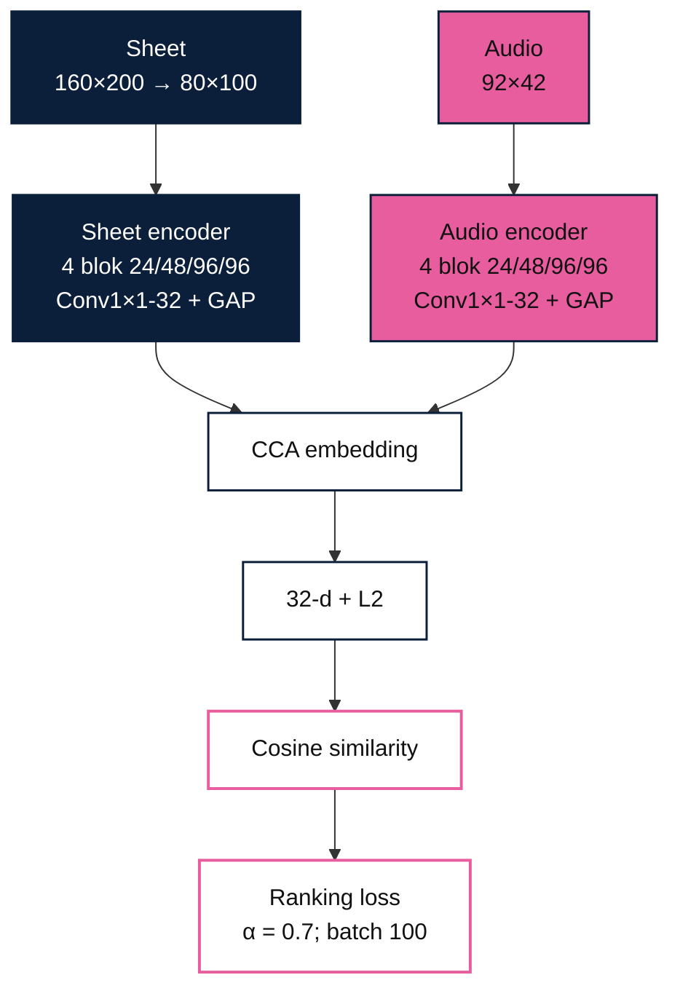
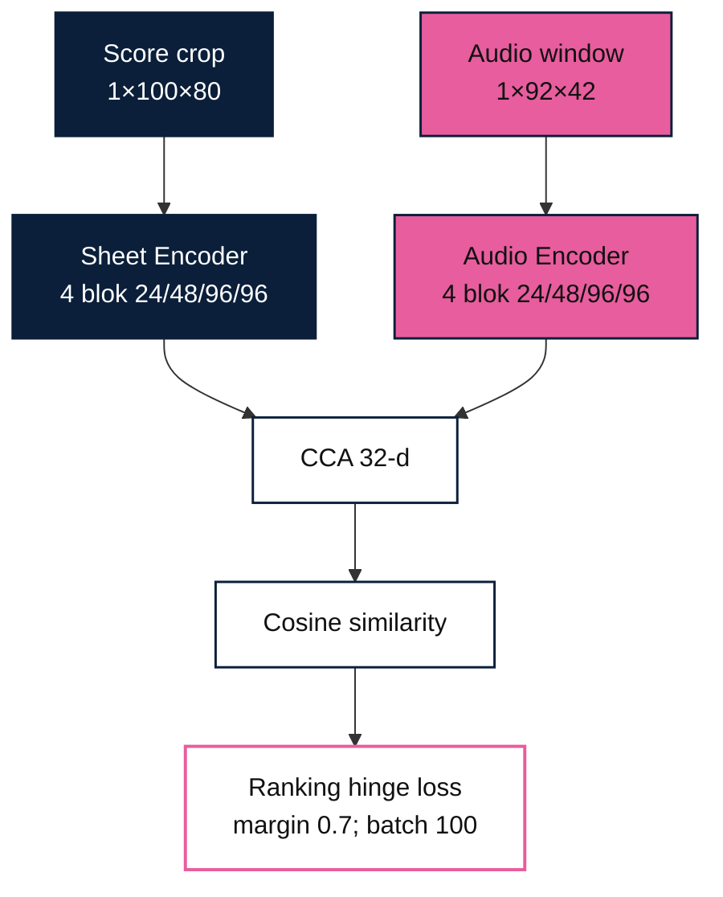
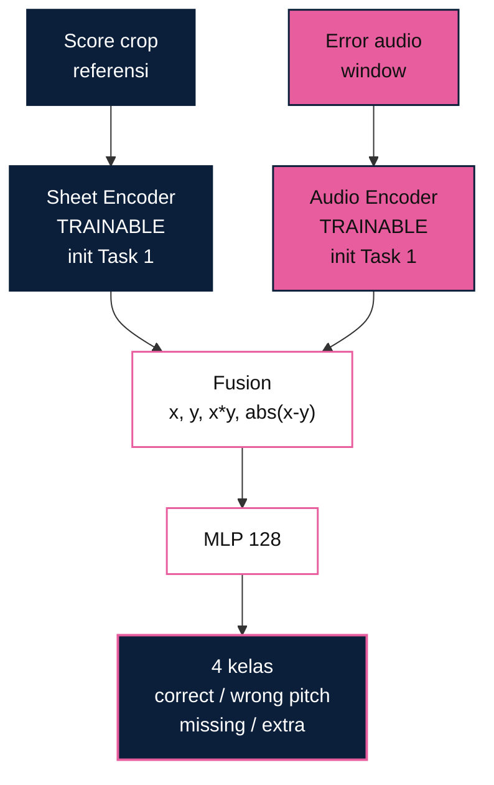
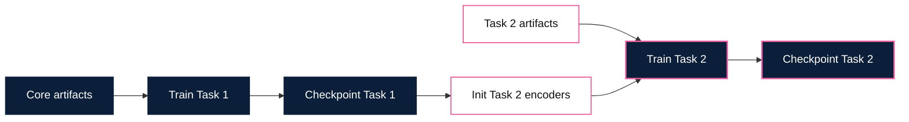

# Dorfer, Dijelaskan dari Nol

Dokumen ini menjelaskan model Dorfer, baseline Task 1, baseline Task 2, dan
hubungan keduanya. Ditulis untuk pembaca yang belum pernah melihat arsitektur
ini.

## Ringkasan

- **Partitur** = gambar nada yang seharusnya dimainkan.
- **Audio** = suara yang benar-benar dimainkan.
- Model Dorfer menerjemahkan keduanya ke vektor 32 angka, lalu membandingkannya
  dengan cosine similarity.
- **Task 1**: diberikan audio, cari bagian partitur yang cocok.
- **Task 2**: diberikan referensi nada dan audio permainan, tentukan benar atau
  jenis kesalahannya.

## 1. Dua modalitas

**Sheet.** Preprocessing memotong crop notehead 160×200 di sekitar satu kepala
nada, lalu diperkecil menjadi 80×100 dan dinormalisasi.

**Audio.** Berupa spectrogram `42×92` (frame × bin frekuensi), ditranspose
menjadi `92×42` agar sesuai input model.

**Pasangan positif.** MSMD menyediakan alignment notehead ↔ onset nada. Pasangan
inilah yang dipakai sebagai contoh "hal yang sama dalam dua bentuk".

## 2. Encoder, embedding, cosine

Encoder adalah penerjemah: gambar atau audio masuk, vektor 32 angka keluar.

```
gambar partitur → [sheet encoder] → vektor 32
audio           → [audio encoder] → vektor 32
```

Encoder-nya CNN:

- **Conv3×3**: mendeteksi pola lokal (garis staff, kepala nada, harmonic, onset).
- **MaxPool 2×2**: memperkecil peta fitur.
- **BN**: menstabilkan training.
- **ELU**: aktivasi non-linear.
- **GAP**: merata-ratakan peta fitur menjadi vektor.

Embedding adalah "sidik jari" isi musik: tinggi nada, pola harmonik, bentuk
notasi, konteks staff. Sebelum dibandingkan, vektor di-L2-normalize sehingga
cosine hanya mengukur arah.

## 3. Ranking loss

Model dilatih dengan pasangan: satu positif dan banyak negatif in-batch.

```
penalti = max(0, margin - skor(pasangan benar) + skor(pasangan salah))
```

Pasangan benar harus lebih mirip daripada pasangan salah dengan selisih minimal
`margin`. Paper dan baseline memakai `margin = 0.7`.

## 4. Model Dorfer



**CCA** menyelaraskan dua ruang fitur agar pasangan yang benar lebih sejajar.
Secara teknis, proyeksi dihitung dari kovarians kedua modalitas. Pada data
pilot, kovarians disimpan sebagai running average (`alpha = 0.05`) agar stabil;
paper memakai `alpha = 1.0` karena dilatih jauh lebih lama.

**Training paper:** Adam `2e-3`, batch 100, 1000 epoch maksimum, augmentasi
gambar (scaling/translasi) dan audio (soundfont/tempo), negatif in-batch.

**Evaluasi paper:** snippet retrieval dua arah (R@1/25, MRR, median rank) dan
piece identification lewat voting top-25.

## 5. Baseline Task 1 — Score–Audio Alignment



Training: 8 epoch maksimum, early stop 3, Adam `2e-3`, weight decay `1e-4`,
CCA warmup 200 step, augmentasi image scale/translate dan audio shift/tempo
jitter ±10%.

Evaluasi:

1. **Snippet retrieval** — R@1/5/10/25, MRR, median rank; paired (2.018
   kandidat) dan extended (8.072 window).
2. **System localization** — page-conditioned, full collection, 5-candidate.
3. **Identification** — voting top-25 ke piece/page.

Hasil (17 train pieces):

| Metrik | Hasil |
|---|---:|
| Val MRR | 0.0100 (random 0.0032) |
| Snippet MRR A→S | 0.0075 (random 0.0037) |
| Page-conditioned R@1 | 26.0% |
| Page-conditioned R@5 | 93.5% |
| 5-candidate R@1 | 27.3% (random 20%) |
| Piece ID Rk@1 | 41.2% (random 33.3%) |

Snippet retrieval masih lemah: 2–3× random. Best epoch 3 lalu val turun, tanda
overfitting pada 17 pieces. Page-conditioned R@5 terlihat tinggi karena satu
halaman hanya berisi 4–5 system.

**Catatan CCA:** dengan `alpha = 1.0`, training loss turun ke 0.03 tetapi
retrieval tetap random karena CCA menghafal statistik batch. Running covariance
`alpha = 0.05` memperbaiki hal ini.

## 6. Baseline Task 2 — Performance Error Detection



Kelas: `correct`, `wrong_pitch`, `missing_note`, `extra_note`.

**Error sintetis.** Untuk setiap window bersih dibuat empat varian: audio asli,
pitch diganti, region nada ditekan, dan attack nada tambahan. Referensi selalu
crop notehead sumber.

**Model.** Kedua encoder diinisialisasi dari Task 1 dan sama-sama dilatih.
Fusion `[x, y, x*y, abs(x-y)]` → MLP 128 → 4 logit. CCA tidak dipakai karena
klasifikasi tidak punya pasangan lintas modalitas.

Training: cross-entropy, encoder `3e-4`, head `1e-3`, batch 256, 8 epoch,
satu varian acak per source per epoch.

Hasil test (3 pieces):

| Metrik | Hasil |
|---|---:|
| 4-class accuracy | 99.54% |
| Macro-F1 | 99.54% |
| Binary error F1 | 99.70% |
| Error-type accuracy (detected) | 100% |
| Coverage error | 99.68% |

Kesalahan tersisa hanya `correct` ↔ `extra_note`. Angka tinggi ini karena error
sintetis, bukan bukti performa pada piano nyata.

## 7. Task 1 → Task 2



Langkah: latih Task 1 → simpan checkpoint → muat bobot ke Task 2 → latih kedua
encoder + classifier → simpan checkpoint Task 2.

**Belum end-to-end.** Task 2 menerima score crop ground truth dari
preprocessing, tidak menjalankan Task 1 lebih dulu. Ini disebut *teacher
forcing*: referensi nada diberikan, lalu model menilai kesalahan audio. Pipeline
end-to-end (Task 1 mencari system → crop → Task 2) belum dievaluasi.

## 8. Glosarium

| Istilah | Arti |
|---|---|
| Modalitas | Jenis data: gambar partitur atau audio. |
| Spectrogram | Gambar energi frekuensi terhadap waktu. |
| Crop notehead | Potongan gambar di sekitar satu kepala nada. |
| Encoder | Jaringan yang mengubah input menjadi vektor. |
| Embedding | Vektor 32 angka hasil encoder. |
| Cosine similarity | Kemiripan arah dua vektor. |
| L2 normalize | Membuat panjang vektor = 1. |
| Positive pair | Pasangan partitur–audio yang cocok. |
| In-batch negatives | Sampel lain dalam batch dipakai sebagai negatif. |
| Ranking loss | Loss yang mendorong positif lebih mirip dari negatif. |
| Margin | Selisih minimal yang harus dicapai (0.7). |
| CCA | Lapisan penyelaras dua ruang fitur. |
| Running covariance | Rata-rata berjalan kovarians agar proyeksi CCA stabil. |
| GAP | Global Average Pooling. |
| Teacher forcing | Memberi model referensi yang benar saat evaluasi. |

## 9. Batasan

- Pilot subset: 17 train pieces, 3 test pieces.
- Task 2 memakai error sintetis dan belum end-to-end.
- Semua soundfont terlihat di train.
- Arsitektur sebanding dengan paper, tetapi angka absolut belum.
