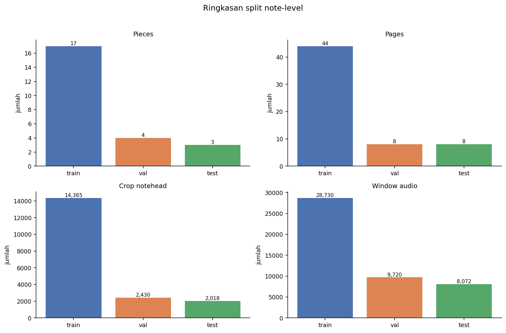
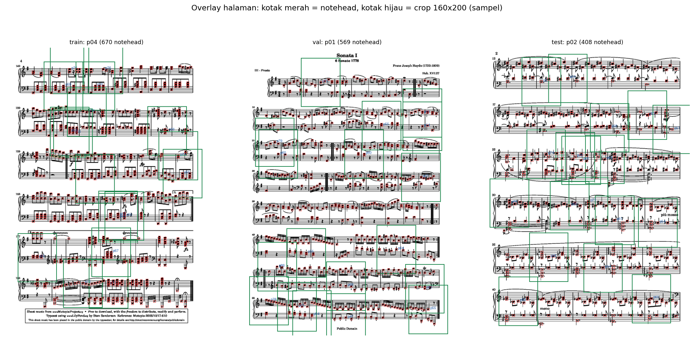
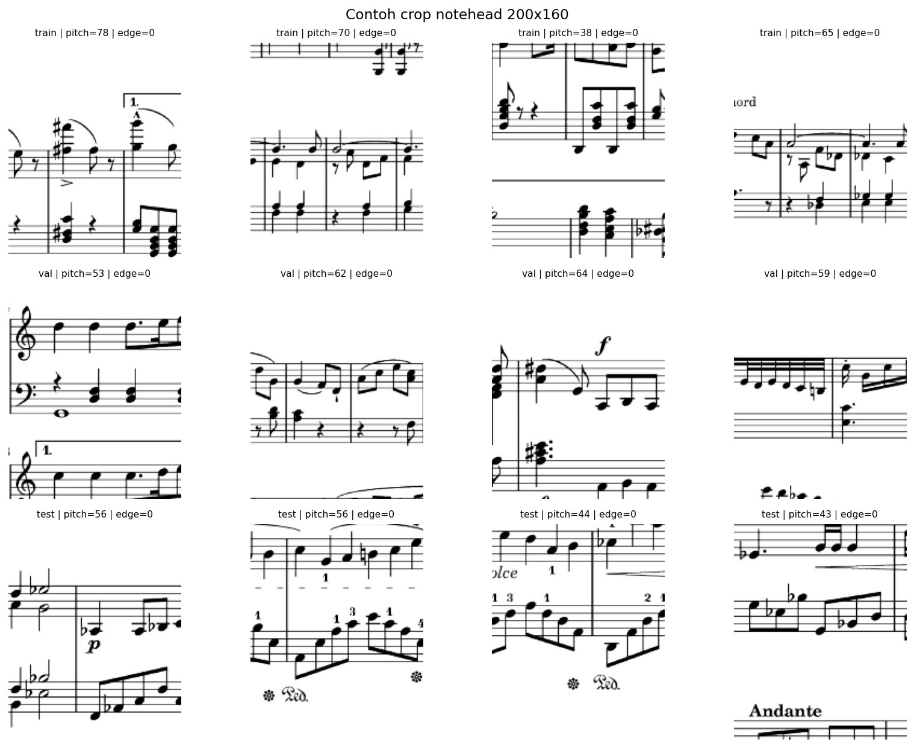
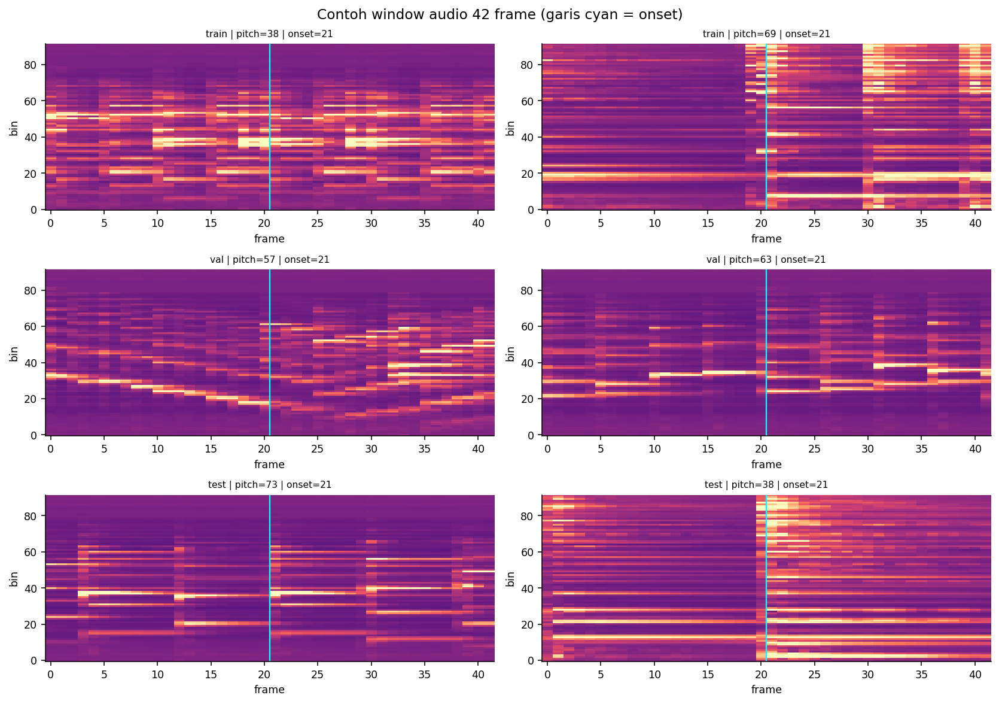
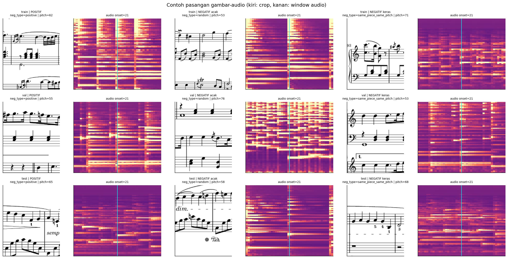
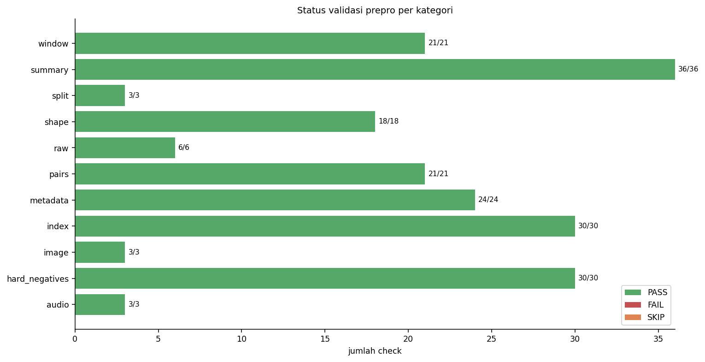
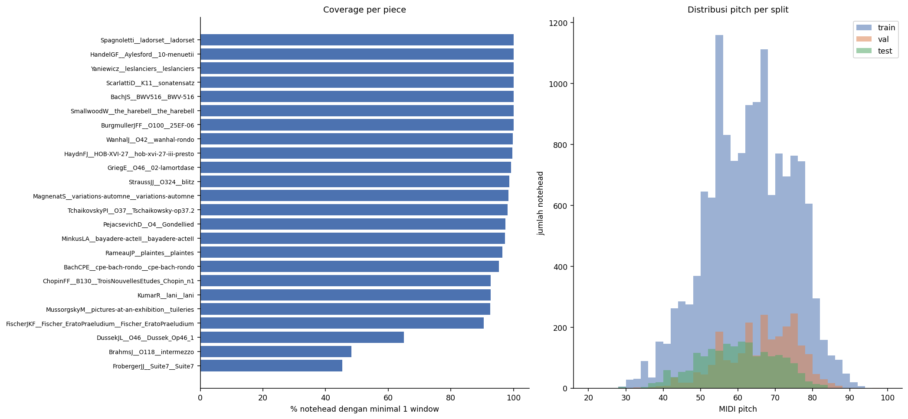

# Laporan Preprocessing Note-Level

Laporan statis untuk reviewer. Buka versi HTML untuk pengalaman lengkap: [`preprocessing_report.html`](preprocessing_report.html). Bukti mentah notebook: [`02_note_level_preprocessing.html`](02_note_level_preprocessing.html).

## Ringkasan

- 24 piece note-level, 60 halaman
- 18.813 crop notehead, 46.522 window audio, 93.044 pair
- 63/63 check awal PASS dan 195/195 check extended PASS
- Total artefak tensor sekitar 1,03 GB

## Split

| split | crop | window | pair |
| --- | --- | --- | --- |
| train | 14365 | 28730 | 57460 |
| val | 2430 | 9720 | 19440 |
| test | 2018 | 8072 | 16144 |

## Validasi

Total check extended: **195**; PASS: **195**; SKIP: **0**; FAIL: **0**.

| category | check | status | detail |
| --- | --- | --- | --- |
| summary | summary: total checks lama 63 | PASS | 63 |
| summary | summary: checks lama semua PASS | PASS |  |
| summary | summary: 24 piece note-level | PASS | 24 |
| summary | summary: GobbaertsL dikecualikan | PASS |  |
| summary | summary: image mean finite | PASS |  |
| summary | summary: image std > 0 | PASS | 0.2651335941081754 |
| summary | summary: audio mean length 92 | PASS | 92 |
| summary | summary: audio std length 92 | PASS | 92 |
| summary | summary: audio mean finite | PASS |  |
| summary | summary: audio std positive | PASS |  |
| summary | summary: crop size konsisten | PASS | (160, 200) |
| summary | summary: window length konsisten | PASS | 42 |
| summary | summary: fps konsisten | PASS | 20 |
| shape | train: crop rows = tensor | PASS | 14365 vs 14365 |
| shape | train: window rows = tensor | PASS | 28730 vs 28730 |
| shape | train: crop shape | PASS | (200, 160, 1) |
| shape | train: window shape | PASS | (42, 92) |
| shape | train: crop dtype | PASS | uint8 |
| shape | train: window dtype | PASS | float16 |
| index | train: notehead_id unik | PASS |  |
| index | train: window_id unik | PASS |  |
| index | train: pair_id unik | PASS |  |
| index | train: crop_row kontigu | PASS |  |
| index | train: window_row kontigu | PASS |  |
| index | train: page_id pattern | PASS |  |
| index | train: page_id/page_num konsisten | PASS |  |
| index | train: mung_id unik per page | PASS |  |
| index | train: png_path konsisten per page | PASS |  |
| index | train: mung_path konsisten per page | PASS |  |
| metadata | train: label hanya 0/1 | PASS | [0, 1] |
| metadata | train: split konsisten | PASS |  |
| metadata | train: pitch 0..127 | PASS | 28..93 |
| metadata | train: tied 0/1 | PASS | [0, 1] |
| metadata | train: edge 0/1 | PASS | [0] |
| metadata | train: pad_frac 0..1 | PASS |  |
| metadata | train: ink_ratio 0..1 | PASS |  |
| metadata | train: page_num > 0 | PASS |  |
| window | train: end_frame - start_frame == 42 | PASS |  |
| window | train: onset_frame == round(onset_s * 20) | PASS |  |
| window | train: onset di dalam window | PASS |  |
| window | train: padding nonnegatif | PASS |  |
| window | train: n_frames > 0 | PASS |  |
| window | train: window_id pattern | PASS |  |
| window | train: perf_name milik piece | PASS | missing=0 |
| pairs | train: pair notehead valid | PASS |  |
| pairs | train: pair window valid | PASS |  |
| pairs | train: positif notehead sama | PASS |  |
| pairs | train: positif piece/work_group sama | PASS |  |
| pairs | train: negatif beda piece | PASS |  |
| pairs | train: negatif beda work_group | PASS |  |
| pairs | train: label seimbang | PASS | pos=28730, neg=28730 |
| image | train: no all-white crop | PASS |  |
| audio | train: audio finite and non-zero | PASS |  |
| raw | train: png_path exists | PASS |  |
| raw | train: mung_path exists | PASS |  |
| shape | val: crop rows = tensor | PASS | 2430 vs 2430 |
| shape | val: window rows = tensor | PASS | 9720 vs 9720 |
| shape | val: crop shape | PASS | (200, 160, 1) |
| shape | val: window shape | PASS | (42, 92) |
| shape | val: crop dtype | PASS | uint8 |
| shape | val: window dtype | PASS | float16 |
| index | val: notehead_id unik | PASS |  |
| index | val: window_id unik | PASS |  |
| index | val: pair_id unik | PASS |  |
| index | val: crop_row kontigu | PASS |  |
| index | val: window_row kontigu | PASS |  |
| index | val: page_id pattern | PASS |  |
| index | val: page_id/page_num konsisten | PASS |  |
| index | val: mung_id unik per page | PASS |  |
| index | val: png_path konsisten per page | PASS |  |
| index | val: mung_path konsisten per page | PASS |  |
| metadata | val: label hanya 0/1 | PASS | [0, 1] |
| metadata | val: split konsisten | PASS |  |
| metadata | val: pitch 0..127 | PASS | 31..96 |
| metadata | val: tied 0/1 | PASS | [0, 1] |
| metadata | val: edge 0/1 | PASS | [0] |
| metadata | val: pad_frac 0..1 | PASS |  |
| metadata | val: ink_ratio 0..1 | PASS |  |
| metadata | val: page_num > 0 | PASS |  |
| window | val: end_frame - start_frame == 42 | PASS |  |
| window | val: onset_frame == round(onset_s * 20) | PASS |  |
| window | val: onset di dalam window | PASS |  |
| window | val: padding nonnegatif | PASS |  |
| window | val: n_frames > 0 | PASS |  |
| window | val: window_id pattern | PASS |  |
| window | val: perf_name milik piece | PASS | missing=0 |
| pairs | val: pair notehead valid | PASS |  |
| pairs | val: pair window valid | PASS |  |
| pairs | val: positif notehead sama | PASS |  |
| pairs | val: positif piece/work_group sama | PASS |  |
| pairs | val: negatif beda piece | PASS |  |
| pairs | val: negatif beda work_group | PASS |  |
| pairs | val: label seimbang | PASS | pos=9720, neg=9720 |
| image | val: no all-white crop | PASS |  |
| audio | val: audio finite and non-zero | PASS |  |
| raw | val: png_path exists | PASS |  |
| raw | val: mung_path exists | PASS |  |
| shape | test: crop rows = tensor | PASS | 2018 vs 2018 |
| shape | test: window rows = tensor | PASS | 8072 vs 8072 |
| shape | test: crop shape | PASS | (200, 160, 1) |
| shape | test: window shape | PASS | (42, 92) |
| shape | test: crop dtype | PASS | uint8 |
| shape | test: window dtype | PASS | float16 |
| index | test: notehead_id unik | PASS |  |
| index | test: window_id unik | PASS |  |
| index | test: pair_id unik | PASS |  |
| index | test: crop_row kontigu | PASS |  |
| index | test: window_row kontigu | PASS |  |
| index | test: page_id pattern | PASS |  |
| index | test: page_id/page_num konsisten | PASS |  |
| index | test: mung_id unik per page | PASS |  |
| index | test: png_path konsisten per page | PASS |  |
| index | test: mung_path konsisten per page | PASS |  |
| metadata | test: label hanya 0/1 | PASS | [0, 1] |
| metadata | test: split konsisten | PASS |  |
| metadata | test: pitch 0..127 | PASS | 29..83 |
| metadata | test: tied 0/1 | PASS | [0, 1] |
| metadata | test: edge 0/1 | PASS | [0] |
| metadata | test: pad_frac 0..1 | PASS |  |
| metadata | test: ink_ratio 0..1 | PASS |  |
| metadata | test: page_num > 0 | PASS |  |
| window | test: end_frame - start_frame == 42 | PASS |  |
| window | test: onset_frame == round(onset_s * 20) | PASS |  |
| window | test: onset di dalam window | PASS |  |
| window | test: padding nonnegatif | PASS |  |
| window | test: n_frames > 0 | PASS |  |
| window | test: window_id pattern | PASS |  |
| window | test: perf_name milik piece | PASS | missing=0 |
| pairs | test: pair notehead valid | PASS |  |
| pairs | test: pair window valid | PASS |  |
| pairs | test: positif notehead sama | PASS |  |
| pairs | test: positif piece/work_group sama | PASS |  |
| pairs | test: negatif beda piece | PASS |  |
| pairs | test: negatif beda work_group | PASS |  |
| pairs | test: label seimbang | PASS | pos=8072, neg=8072 |
| image | test: no all-white crop | PASS |  |
| audio | test: audio finite and non-zero | PASS |  |
| raw | test: png_path exists | PASS |  |
| raw | test: mung_path exists | PASS |  |
| split | split train vs val disjoint | PASS | overlap=[] |
| split | split train vs test disjoint | PASS | overlap=[] |
| split | split val vs test disjoint | PASS | overlap=[] |
| hard_negatives | train: hard pair_id unik | PASS |  |
| hard_negatives | train: hard label 0 | PASS |  |
| hard_negatives | train: hard notehead/window valid | PASS |  |
| hard_negatives | train: hard beda notehead | PASS |  |
| hard_negatives | train: hard neg_type valid | PASS | ['same_piece_random', 'same_piece_same_pitch'] |
| hard_negatives | train: hard same-piece konsisten | PASS |  |
| hard_negatives | train: hard cross-piece konsisten | PASS |  |
| hard_negatives | train: hard same-pitch konsisten | PASS |  |
| hard_negatives | train: hard tidak menyalin positif | PASS |  |
| hard_negatives | train: hard count = notehead | PASS | 14365 vs 14365 |
| hard_negatives | val: hard pair_id unik | PASS |  |
| hard_negatives | val: hard label 0 | PASS |  |
| hard_negatives | val: hard notehead/window valid | PASS |  |
| hard_negatives | val: hard beda notehead | PASS |  |
| hard_negatives | val: hard neg_type valid | PASS | ['same_piece_random', 'same_piece_same_pitch'] |
| hard_negatives | val: hard same-piece konsisten | PASS |  |
| hard_negatives | val: hard cross-piece konsisten | PASS |  |
| hard_negatives | val: hard same-pitch konsisten | PASS |  |
| hard_negatives | val: hard tidak menyalin positif | PASS |  |
| hard_negatives | val: hard count = notehead | PASS | 2430 vs 2430 |
| hard_negatives | test: hard pair_id unik | PASS |  |
| hard_negatives | test: hard label 0 | PASS |  |
| hard_negatives | test: hard notehead/window valid | PASS |  |
| hard_negatives | test: hard beda notehead | PASS |  |
| hard_negatives | test: hard neg_type valid | PASS | ['same_piece_random', 'same_piece_same_pitch'] |
| hard_negatives | test: hard same-piece konsisten | PASS |  |
| hard_negatives | test: hard cross-piece konsisten | PASS |  |
| hard_negatives | test: hard same-pitch konsisten | PASS |  |
| hard_negatives | test: hard tidak menyalin positif | PASS |  |
| hard_negatives | test: hard count = notehead | PASS | 2018 vs 2018 |
| summary | train: crop count = summary | PASS | 14365 vs 14365 |
| summary | train: window count = summary | PASS | 28730 vs 28730 |
| summary | train: pair count = summary | PASS | 57460 vs 57460 |
| summary | train: coverage pieces = noteheads pieces | PASS | 17 vs 17 |
| summary | train: coverage mapped = noteheads CSV | PASS | 14365 vs 14365 |
| summary | train: coverage windows = windows CSV | PASS | 28730 vs 28730 |
| summary | train: coverage total >= mapped | PASS |  |
| summary | val: crop count = summary | PASS | 2430 vs 2430 |
| summary | val: window count = summary | PASS | 9720 vs 9720 |
| summary | val: pair count = summary | PASS | 19440 vs 19440 |
| summary | val: coverage pieces = noteheads pieces | PASS | 4 vs 4 |
| summary | val: coverage mapped = noteheads CSV | PASS | 2430 vs 2430 |
| summary | val: coverage windows = windows CSV | PASS | 9720 vs 9720 |
| summary | val: coverage total >= mapped | PASS |  |
| summary | test: crop count = summary | PASS | 2018 vs 2018 |
| summary | test: window count = summary | PASS | 8072 vs 8072 |
| summary | test: pair count = summary | PASS | 16144 vs 16144 |
| summary | test: coverage pieces = noteheads pieces | PASS | 3 vs 3 |
| summary | test: coverage mapped = noteheads CSV | PASS | 2018 vs 2018 |
| summary | test: coverage windows = windows CSV | PASS | 8072 vs 8072 |
| summary | test: coverage total >= mapped | PASS |  |
| summary | coverage: pct_mapped formula | PASS |  |
| summary | coverage: all 0..100 | PASS |  |

## Visualisasi















## Coverage per piece

| piece | split | n_pages | n_noteheads | n_mapped_noteheads | n_valid_windows | pct_mapped |
| --- | --- | --- | --- | --- | --- | --- |
| HandelGF__Aylesford__10-menuetii | train | 1 | 287 | 287 | 574 | 100.0000 |
| Yaniewicz__leslanciers__leslanciers | val | 1 | 239 | 239 | 956 | 100.0000 |
| ScarlattiD__K11__sonatensatz | val | 2 | 551 | 551 | 2204 | 100.0000 |
| Spagnoletti__ladorset__ladorset | val | 2 | 429 | 429 | 1716 | 100.0000 |
| BachJS__BWV516__BWV-516 | train | 1 | 131 | 131 | 262 | 100.0000 |
| BurgmullerJFF__O100__25EF-06 | train | 1 | 213 | 213 | 426 | 100.0000 |
| SmallwoodW__the_harebell__the_harebell | train | 2 | 403 | 403 | 806 | 100.0000 |
| WanhalJ__O42__wanhal-rondo | train | 1 | 379 | 378 | 756 | 99.7400 |
| HaydnFJ__HOB-XVI-27__hob-xvi-27-iii-presto | val | 3 | 1216 | 1211 | 4844 | 99.5900 |
| GriegE__O46__02-lamortdase | train | 3 | 761 | 755 | 1510 | 99.2100 |
| StraussJJ__O324__blitz | train | 4 | 2469 | 2436 | 4872 | 98.6600 |
| MagnenatS__variations-automne__variations-automne | test | 2 | 561 | 552 | 2208 | 98.4000 |
| TchaikovskyPI__O37__Tschaikowsky-op37.2 | train | 6 | 2048 | 2008 | 4016 | 98.0500 |
| PejacsevichD__O4__Gondellied | train | 2 | 663 | 646 | 1292 | 97.4400 |
| MinkusLA__bayadere-acteII__bayadere-acteII | train | 2 | 1015 | 988 | 1976 | 97.3400 |
| RameauJP__plaintes__plaintes | train | 2 | 685 | 661 | 1322 | 96.5000 |
| BachCPE__cpe-bach-rondo__cpe-bach-rondo | train | 3 | 1824 | 1739 | 3478 | 95.3400 |
| ChopinFF__B130__TroisNouvellesEtudes_Chopin_n1 | test | 3 | 829 | 769 | 3076 | 92.7600 |
| KumarR__lani__lani | test | 3 | 752 | 697 | 2788 | 92.6900 |
| MussorgskyM__pictures-at-an-exhibition__tuileries | train | 2 | 682 | 631 | 1262 | 92.5200 |
| FischerJKF__Fischer_EratoPraeludium__Fischer_EratoPraeludium | train | 1 | 345 | 312 | 624 | 90.4300 |
| DussekJL__O46__Dussek_Op46_1 | train | 6 | 2133 | 1387 | 2774 | 65.0300 |
| BrahmsJ__O118__intermezzo | train | 4 | 1698 | 818 | 1636 | 48.1700 |
| FrobergerJJ__Suite7__Suite7 | train | 3 | 1262 | 572 | 1144 | 45.3200 |

## Hard negatives

| split | hard_negatives | same_piece | same_pitch |
| --- | --- | --- | --- |
| train | 14365 | 14365 | 14318 |
| val | 2430 | 2430 | 2416 |
| test | 2018 | 2018 | 2004 |

## Batasan

- Subset 25 piece; note-level 24 piece karena satu piece tidak punya MuNG.
- Test hanya 3 piece.
- Coverage rendah untuk Froberger dan Brahms.
- Crop 160x200 dapat memuat lebih dari satu system.
- Negatif lama hanya cross-piece; hard negatives disiapkan terpisah.
- Belum ada raw audio dan belum ada model/training.

## Verifikasi

```powershell
python scripts/validate_preprocessing.py --check-raw-paths
```
